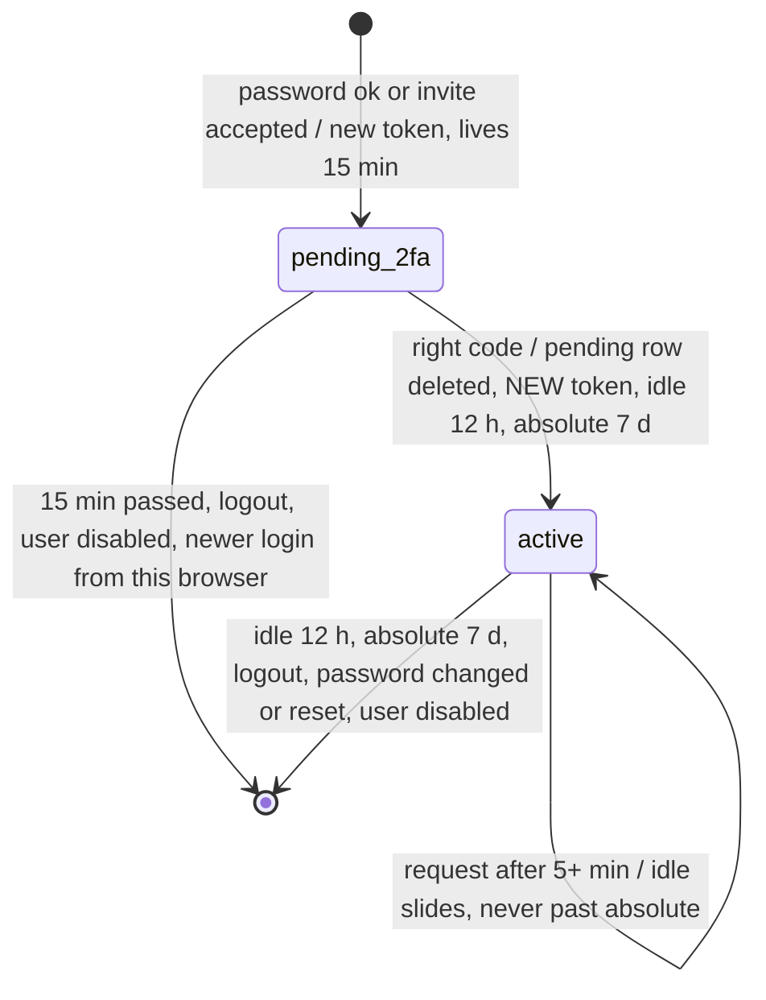
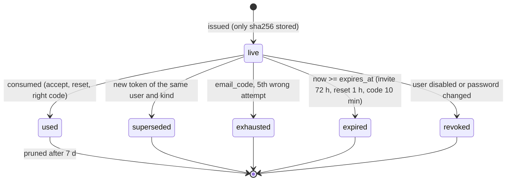
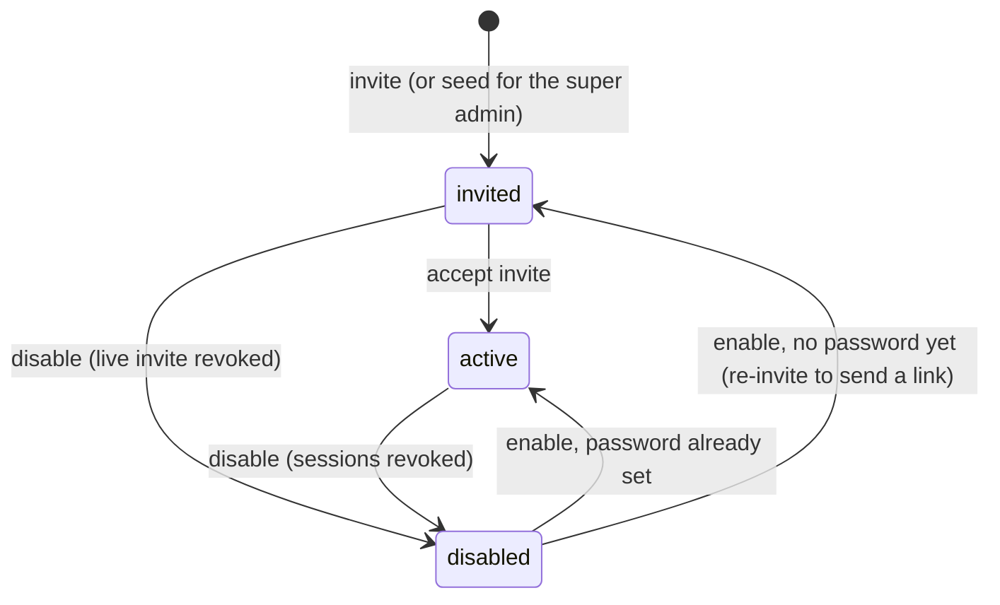

# F1 · Technical plan: foundation and access (F1b, F1c, F1d, F1e interface)

Owner: Alex · Written D3 (Sun 22 Nov 2026) · Inputs: CLAUDE.md, PRD F1, specs F1a–F1e, CONTRACTS.md, ARCHITECTURE §1–§8, ORDER Phase 1, and the repo as of `446a9db` plus the uncommitted F1b work.
Rules this plan keeps: three roles (`super_admin | manager | client`, no nesting); no new dependencies; Node built-in crypto only; web (BFF, no DB) → api routes → services → db; tenant data only through `withTenant` / `withSystem`.

---

## 1. Current state vs target

| Item | Exists? | Action |
|---|---|---|
| `api/src/contracts/common.ts` `role` = `admin\|manager\|agent` | yes, wrong | Change to `super_admin\|manager\|client` (§2) |
| `common.ts` `changeKind` includes `link` | yes, wrong | Remove `link` |
| `contracts/session.ts` `actionMinRole` (nested roles; has `link.manage`, `agency.manage`) | yes, wrong | Replace with `actionRoles` + pure `can()` (§2) |
| `contracts/jobs.ts` `email.send.template: z.string()` | yes, loose | Narrow to `emailTemplate` enum |
| Auth and audit request/response schemas | no | Add `contracts/auth.ts`, `contracts/audit.ts` |
| `CONTRACTS_VERSION = '1.0.0'` | yes | Bump to `2.0.0` (breaking) |
| `api/src/db/index.ts` (`Db`, `Tx`, memoised `getDb`) — uncommitted | yes, correct | Keep |
| `0000_init.sql` | pushed | Never touch |
| `0001_base_tables.sql` + `meta/0001_snapshot.json` — untracked | yes, wrong | Delete and regenerate: old role enum, `client_links`, `agency_settings`, missing columns/indexes |
| `0002_roles_rls.sql` + `meta/0002_snapshot.json` — untracked | yes, wrong | Delete and rewrite: `app_is_admin()` checks `'admin'`, no `client_access`, managers can't see every client, clients can read staff-only tables, `project_members` not readable from `withSystem(null)` |
| `meta/_journal.json` — modified | yes | `git checkout` it, then regenerate |
| `db/schema/{columns,enums,refs}.ts` | yes, correct | Keep. `enums.ts` takes `userStatus`/`sessionStage` from the contracts |
| `db/schema/index.ts` barrel | yes | Drop the `client-link` export (never pushed); fix the comment to `app_secure_tenant_table('<t>', '<client_access>')` |
| `modules/auth/schema.ts` | yes, partly | `role` has no default (was `'agent'`); add `users.invited_by`, `auth_tokens.session_id`, unique/partial indexes (§3) |
| `modules/projects/schema.ts` `agency_settings` | yes, wrong | Delete the table; add `projects.first_reply_minutes`, unique `lower(name)` |
| `modules/client-link/schema.ts` (`client_links` + `qualification_settings`) | yes, wrong | Delete `client_links`; move `qualification_settings` unchanged to `modules/leads/schema.ts`; delete the folder |
| `lib/tenant/schema.ts` `project_members` | yes, partly | Add `unique(user_id)` (one client per user) |
| Other module schemas (contacts, leads, pipeline, tasks, conversion, whatsapp, hub, webhooks, notifications, automation, audit, errors, rate-limit) | yes, correct | Keep. Extra indexes on `audit_log` and `rate_limits` (§3) |
| `lib/tenant/index.ts` `withTenant` / `withSystem` / `emitChange` | yes, correct shape | Keep. Fix the comments ("admins", "portal"); `Role` follows the contract |
| `tests/rls/structure.test.ts` | yes, partly | Also check each tenant table is registered with the expected `client_access` and has 4 policies |
| `tests/rls/isolation.test.ts`, `tests/helpers/db.ts` | yes, wrong | Rewrite the world as super admin / manager / client A / client B; drop `client_links`; add the role × table × operation matrix |
| `tests/rls/no-raw-pool.test.ts` | yes, correct | Keep |
| `lib/crypto`, `lib/email`, `lib/errors` (index), `lib/rate-limit` (index) | `.gitkeep` only | Build (§4) |
| `lib/log/index.ts` | yes, correct | Add `redact.ts` |
| `lib/http`, `lib/context`, `lib/queue` | no | New (route guard, request context, job producer) |
| `modules/auth` service/routes, `modules/audit` service/routes | no | Build |
| `worker/index.ts` | example queue only | Replace with the queue registry and the `email.send` + `maintenance` consumers |
| `app.ts` | health only | Register the http plugin and the auth, users and audit routes |
| `/health` `checks.queue` | stubbed `'unknown'` | Real check in F1d |
| `lib/env.ts` (api) | yes | Add `INTERNAL_API_TOKEN` (§10 D2) |
| `db/migrate.ts` comment says "pre-deploy step for the web service" | yes, wrong | Change to "api service" (same commit as T1) |
| `web/src/lib/env.ts` | `SESSION_SECRET` unused by this design; `LEADS_URL` belongs to the removed client link | Replace `SESSION_SECRET` with `INTERNAL_API_TOKEN`; John decides when to drop `LEADS_URL` |
| `web/src/lib/api/client.ts` | yes, no session | Add internal token, session token, client IP, request id, typed error parsing |
| `web/src/proxy.ts` | next-intl only; comment mentions F10a leads-host rules | Add CSP nonce and the cookie guard; delete the leads-host comment |
| `web/next.config.ts` | no security headers | Add static headers (§7) |
| `web/src/app/[locale]/(auth)/*`, `web/src/lib/session.ts`, `web/src/lib/action.ts`, `web/messages/en/{auth,errors}.json` | no | Build |
| `skills/sharkx-brand-guidelines` | yes | Read before the auth screens (T10b) |

---

## 2. Contract changes (one `contracts:` commit, T0, before any F1b push)

Breaking. John has to agree before the push (CONTRACTS.md header). After it: `node scripts/sync-contracts.mjs`, then both apps typecheck.

### 2.1 `common.ts`
| Change | Kind |
|---|---|
| `role = z.enum(['super_admin', 'manager', 'client'])` | **breaking** (`admin` renamed, `agent` removed) |
| `changeKind = z.enum(['lead', 'message', 'task', 'health', 'notification'])` | **breaking** (`link` removed) |
| `userStatus = z.enum(['invited', 'active', 'disabled'])` | additive (moved from `db/schema/enums.ts`) |
| `sessionStage = z.enum(['active', 'pending_2fa'])` | additive (was inline in `session`) |
| `email = z.string().trim().toLowerCase().max(254).pipe(z.email())` | additive |
| `password = z.string().min(12).max(128).regex(/[A-Za-z]/).regex(/\d/)` | additive (F1c S4 rules: 12+ characters, a letter and a number) |
| `opaqueToken = z.string().regex(/^[A-Za-z0-9_-]{43}$/)` (32 bytes, base64url) | additive |
| `errorCode = z.enum(Object.keys(errorStatus))`; `errorBody = z.object({ error: z.object({ code: errorCode, details: z.record(z.string(), z.unknown()).optional(), retryAfterSec: z.number().int().positive().optional() }) })` | additive (one error shape for every api response) |

### 2.2 `session.ts`
- `session` keeps its shape: `{ userId, role, projectIds: uuid[], locale, stage: sessionStage }`. Invariant (documented, not typed): staff `projectIds = []`, client `projectIds = [itsProjectId]`.
- `actionMinRole` is **removed** (breaking). It is replaced by:
```ts
export const actionRoles = {
  'project.read': ALL, 'lead.read': ALL, 'lead.mark': ALL, 'lead.export': ALL,
  'chat.read': ALL, 'report.read': ALL, 'integration.manage': ALL,
  'contact.read': STAFF, 'lead.update': STAFF, 'lead.assign': STAFF, 'chat.note': STAFF,
  'task.manage': STAFF, 'pipeline.manage': STAFF, 'automation.manage': STAFF,
  'conversion.manage': STAFF, 'qualification.manage': STAFF, 'project.update': STAFF,
  'clientuser.manage': STAFF,
  'project.create': SUPER, 'user.manage': SUPER, 'audit.read': SUPER,
} as const satisfies Record<string, readonly Role[]>;
// ALL = ['super_admin','manager','client'], STAFF = ['super_admin','manager'], SUPER = ['super_admin']
export type Action = keyof typeof actionRoles;
export const action: z.ZodEnum<...>;  // z.enum over the keys
export function can(s: Pick<Session, 'role' | 'projectIds' | 'stage'>, a: Action, projectId?: string): boolean;
```
- Removed actions: `link.manage`, `agency.manage` (`integration.test` was never in the file). Added: `contact.read`, `lead.mark`, `qualification.manage`, `clientuser.manage`.
- `can()` rules: `stage === 'pending_2fa'` → false; role not in `actionRoles[a]` → false; role `client` → true only when `projectId` is given **and** is in `projectIds`; staff ignore `projectId`.
- Why `can()` lives in the contracts: it is pure and imports only types, so the web copy and the api run the same table. Web uses it for UX (hide, early refuse); the api is the enforcement point.

### 2.3 `auth.ts` (new, additive)
| Schema | Shape |
|---|---|
| `loginRequest` | `{ email, password: z.string().min(1).max(128) }` (no strength rule at login) |
| `pendingSessionResponse` | `{ stage: z.literal('pending_2fa'), sessionToken: opaqueToken, expiresAt: iso, maskedEmail: z.string() }` (login and accept-invite) |
| `verifyCodeRequest` | `{ code: z.string().regex(/^\d{6}$/) }` |
| `activeSessionResponse` | `{ stage: z.literal('active'), sessionToken: opaqueToken, expiresAt: iso, me: meResponse }` |
| `codeSentResponse` | `{ maskedEmail: z.string(), expiresAt: iso }` |
| `meResponse` | `session.extend({ name: z.string(), email })` |
| `updateMeRequest` | `{ locale }` (F2a stores the language per user) |
| `resetRequest` | `{ email }` |
| `resetConfirmRequest` | `{ token: opaqueToken, password }` |
| `tokenRequest` | `{ token: opaqueToken }` |
| `inviteInfoResponse` | `{ kind: userKind, name, maskedEmail, inviterName: z.string().nullable(), projectName: z.string().nullable() }` |
| `acceptInviteRequest` | `{ token: opaqueToken, password }` |
| `userKind` | `z.enum(['manager', 'client'])` |
| `inviteRequest` | `z.discriminatedUnion('kind', [ { kind: 'manager', email, name: z.string().trim().min(1).max(120) }, { kind: 'client', email, name, projectId: z.uuid() } ])` |
| `userSummary` | `{ id: uuid, name, email, role, status: userStatus, projectId: uuid.nullable(), createdAt: iso }` |
| `listUsersQuery` | `z.discriminatedUnion('kind', [ { kind: 'manager' }, { kind: 'client', projectId: uuid } ])` |
| `listUsersResponse` | `{ users: userSummary[] }` |
| `setUserStatusRequest` | `{ status: z.enum(['active', 'disabled']) }` |
| `okResponse` | `{ ok: z.literal(true) }` |

### 2.4 `audit.ts` (new, additive; the F1e interface)
| Schema | Shape |
|---|---|
| `auditAction` | `z.string().regex(/^[a-z_]+\.[a-z_]+$/)` |
| `knownAuditActions` | `as const` list for the viewer's filter: `auth.login, auth.login_failed, auth.code_verified, auth.logout, auth.reset_requested, auth.password_changed, user.invited, user.invite_accepted, user.status_changed`. Each module appends its own actions (`project.created`, `lead.marked`, `integration.connected`…) in an additive `contracts:` commit |
| `auditQuery` | `{ userId?: uuid, action?: auditAction, projectId?: uuid, from?: iso, to?: iso, cursor?: z.string().max(200), limit: z.coerce.number().int().min(1).max(100).default(50) }` |
| `auditEntry` | `{ id, at: iso, actorKind, actorId: uuid.nullable(), actorName: string.nullable(), actorRole: role.nullable(), projectId: uuid.nullable(), projectName: string.nullable(), action, entity: string.nullable(), entityId: string.nullable(), meta: z.record(z.string(), z.unknown()) }` |
| `auditPage` | `{ entries: auditEntry[], nextCursor: z.string().nullable() }` (keyset on `(at desc, id desc)`; the cursor is opaque base64url) |

### 2.5 `jobs.ts`
- `emailTemplate = z.enum(['invite', 'code', 'reset', 'alert'])`; `'email.send'.template: emailTemplate`. This narrows the type, but nothing produces it yet. Later templates (`task_due`, `connection_issue`…) are added by their owners as new enum values (additive).

### 2.6 `index.ts`
- Export `auth.ts` and `audit.ts`; `CONTRACTS_VERSION = '2.0.0'`.

### 2.7 Who must be told
- **John**, before the push: the whole commit. He uses `role`, `can`/`actionRoles`, `changeKind`, the user and audit shapes, and `errorBody` (his `apiCall` errors).
- Docs, in the same day's docs commit (T21): CONTRACTS.md §1 (`can()` lives in contracts), §6 (auth, users and audit routes), version 2.0.0.

---

## 3. Data model

### 3.1 Tables and columns touched (all in the regenerated `0001`)
| Table | Columns (bold = change vs the untracked 0001) | Keys / indexes |
|---|---|---|
| `users` | id, email, name, **role (no default)**, pw_hash null, locale, status, **invited_by uuid null → users(id) on delete set null**, created_at, updated_at | **`unique(email)` + `check (email = lower(email))`** (replaces the `lower(email)` expression index, so lookups are a plain `email = $1`); **`users_one_super_admin`: unique on `((1)) where role = 'super_admin'`** (hand-written in 0002) |
| `sessions` | id, token_hash, user_id, stage (default pending_2fa), idle_expires_at, expires_at, created_at | `unique(token_hash)`, `(user_id)`, **`(expires_at)`** for pruning |
| `auth_tokens` | id, user_id, kind, token_hash, **session_id uuid null → sessions(id) on delete cascade**, expires_at, attempts, used_at, created_at | **`unique(token_hash)`**; **partial unique `auth_tokens_one_live (user_id, kind) where used_at is null`** (one live token per user and kind, race-safe); **`(session_id)`**, **`(expires_at)`**; **`check ((kind = 'email_code') = (session_id is not null))`** |
| `project_members` | id, project_id, user_id, created_at | `unique(project_id, user_id)`, **`unique(user_id)`** (replaces `pm_user_idx`) |
| `projects` | + **first_reply_minutes int not null default 15** | **unique index on `lower(name)`** (F2b rule, added now to save John a migration) |
| `audit_log` | unchanged columns | **`(at, id)`** (keyset; replaces `audit_at_idx`), `(project_id, at)`, **`(actor_id, at)`**, **`(action, at)`** |
| `rate_limits` | unchanged | PK `(key, window_start)`, **`(window_start)`** for pruning |
| `change_feed` | `kind` enum loses `link` | unchanged |
| `qualification_settings` | unchanged; **file moves** to `modules/leads/schema.ts` | `unique(project_id)` |
| `client_links` | **dropped** | — |
| `agency_settings` | **dropped** | — |

Enums in 0001: `role ('super_admin','manager','client')`, `change_kind` without `link`. The other enums are unchanged.

### 3.2 RLS design (`0002_roles_rls.sql`, hand-written)
Session-context readers (an unset value gives NULL, so policies match nothing):
```sql
app_user_id()        -> uuid   -- app.user_id
app_project_id()     -> uuid   -- app.project_id (system context)
app_role()           -> text   -- app.role
app_is_staff()       -> bool   -- current_user = 'app_user' AND app_role() IN ('super_admin','manager')
app_client_project() -> uuid   -- SELECT project_id FROM project_members WHERE app_role() = 'client' AND user_id = app_user_id()
```
All are `LANGUAGE sql STABLE`, security invoker (never `SECURITY DEFINER`). The policies call `(SELECT app_client_project())`, so it runs once per statement (initplan), not once per row. That works because a client has exactly one project.

Registry and policy generator:
```sql
CREATE TABLE tenant_tables (table_name text PRIMARY KEY,
  client_access text NOT NULL CHECK (client_access IN ('none','read','write')));   -- no grants to app roles

CREATE FUNCTION app_secure_tenant_table(t regclass, client_access text,
                                        key text DEFAULT 'project_id', client_filter text DEFAULT 'true')
-- upserts tenant_tables; ENABLE + FORCE RLS; drops tenant_* policies; then:
--   S := (app_is_staff() OR (current_user = 'app_system' AND <key> = app_project_id()))
--   C := (<key> = (SELECT app_client_project()) AND (<client_filter>))
--   tenant_read   FOR SELECT USING (S OR (<access> IN ('read','write') AND C))
--   tenant_insert FOR INSERT WITH CHECK (S OR (<access> = 'write' AND C))
--   tenant_update FOR UPDATE USING (same as insert) WITH CHECK (same)
--   tenant_delete FOR DELETE USING (S)
--   GRANT SELECT, INSERT, UPDATE, DELETE ON t TO app_user, app_system
```
`write` lets a client SELECT, INSERT and UPDATE; DELETE is always staff or system. Column limits stay in services (ARCHITECTURE §4): only the marking service changes `leads.status`, `status_seq` and `reason` for a client.

Per-table registration (the structure test holds this map; changing it means changing the test):

| Table | key | client_access | client_filter | Extra |
|---|---|---|---|---|
| projects | `id` | read | — | `projects_list` FOR SELECT TO app_system USING (true) (cron loops) |
| pipeline_stages | project_id | none | — | |
| contacts | project_id | read | — | |
| leads | project_id | write | — | service limits client updates to the mark columns |
| lead_events | project_id | none | — | |
| lead_forms | project_id | write | — | connectors |
| notes | project_id | none | — | |
| tasks | project_id | none | — | |
| qualification_settings | project_id | read | — | |
| automation_rules | project_id | none | — | |
| integrations | project_id | write | — | connectors |
| integration_tokens | project_id | none | — | `REVOKE ALL ON integration_tokens FROM app_user` (system only) |
| wa_numbers | project_id | write | — | connectors |
| wa_conversations | project_id | read | — | |
| wa_messages | project_id | read | — | |
| conversion_mappings | project_id | none | — | |
| conversion_events | project_id | none | — | |
| change_feed | project_id | read | `kind IN ('lead','message','health','notification')` | `change_feed_prune` FOR DELETE TO app_system USING (app_project_id() IS NULL AND at < now() - interval '7 days') |
| notifications | project_id | write | `user_id = app_user_id()` | client reads and marks only its own; **new vs ARCHITECTURE §4** (not listed there) |

Exceptions (hand-written policies, not registered):
- `project_members` (ENABLE + FORCE):
  - `members_read` FOR SELECT: `app_is_staff() OR user_id = app_user_id() OR current_user = 'app_system'`. System reads every membership, because session resolution runs in `withSystem(null)`.
  - `members_write` FOR INSERT, UPDATE, DELETE: `app_is_staff() OR (current_user = 'app_system' AND project_id = app_project_id())`.
- `audit_log` (ENABLE + FORCE; GRANT SELECT, INSERT only):
  - `audit_insert`: `(current_user = 'app_system' AND (project_id IS NULL OR project_id = app_project_id())) OR (current_user = 'app_user' AND actor_id = app_user_id() AND (project_id IS NULL OR app_is_staff() OR project_id = (SELECT app_client_project())))`. A web user cannot write audit rows in someone else's name.
  - `audit_read`: `(current_user = 'app_user' AND app_role() = 'super_admin') OR (current_user = 'app_system' AND project_id IS NOT NULL AND project_id = app_project_id())`. Managers and clients read nothing.
- `users` (**new**: ENABLE + FORCE):
  - `users_read` FOR SELECT TO app_user: `app_is_staff() OR id = app_user_id()`.
  - `users_system` FOR ALL TO app_system USING (true) WITH CHECK (true).
  - Column grant to app_user: SELECT on every column except `pw_hash` (kept).
- `sessions`, `auth_tokens`, `rate_limits`, `error_log`, `webhook_events`: grants only, all to app_system, nothing to app_user (kept).
- `GRANT USAGE, SELECT ON ALL SEQUENCES IN SCHEMA public TO app_user, app_system` (kept).

The owner/migrator is the Postgres superuser locally and on Railway, so FORCE never blocks migrations. All seeds go through `withSystem` anyway.

### 3.3 Migration plan
1. `git checkout api/src/db/migrations/meta/_journal.json`; delete `0001_base_tables.sql`, `0002_roles_rls.sql`, `meta/0001_snapshot.json`, `meta/0002_snapshot.json` (all untracked, never pushed).
2. Fix the schema TS (T1). `git pull --rebase`, then `cd api && pnpm db:generate --name base_tables` produces `0001_base_tables.sql` and its snapshot.
3. `pnpm drizzle-kit generate --custom --name roles_rls` (through the same `node --env-file-if-exists` wrapper) produces an empty `0002_roles_rls.sql`; write it by hand, in this order:
   1. roles `app_user`, `app_system` (NOLOGIN, idempotent `DO` block) and `GRANT … TO current_user`;
   2. schema usage;
   3. context functions;
   4. `tenant_tables` and `app_secure_tenant_table`;
   5. the 19 registrations;
   6. the `projects_list` and `change_feed_prune` policies;
   7. the `project_members`, `audit_log` and `users` policies;
   8. the grants;
   9. `users_one_super_admin`.

   Every statement ends with `--> statement-breakpoint`.
4. Push both migrations the same day as T1–T3 (single lane). From then on every new tenant table calls `app_secure_tenant_table('<t>', '<access>')` in its own migration.

---

## 4. Module layout

### 4.1 api
| File | Job |
|---|---|
| `src/contracts/{common,session,jobs,index}.ts` | §2 changes |
| `src/contracts/auth.ts`, `src/contracts/audit.ts` | New shapes (§2.3, §2.4) |
| `src/contracts/session.test.ts` | Full `can()` matrix: action × role × (own, other, no project) × stage |
| `src/db/schema/enums.ts` | `userStatusEnum`/`sessionStageEnum` take values from the contracts |
| `src/db/schema/index.ts` | Remove `client-link`; fix the comment |
| `src/db/migrations/0001_*.sql`, `0002_*.sql` | §3.3 |
| `src/db/seed-super-admin.ts` | `pnpm auth:seed-admin --email --name`: creates the single super admin (status `invited`) through `withSystem(null)` and sends the invite (prints the link only when `APP_ENV=local`) |
| `src/lib/env.ts` | + `INTERNAL_API_TOKEN: z.string().min(32)` in `apiSchema` |
| `src/lib/crypto/index.ts` | `hashPassword(pw): Promise<string>`, `verifyPassword(pw, stored): Promise<boolean>`, `needsRehash(stored): boolean`, `DUMMY_HASH`, `randomToken(): string`, `randomCode(): string`, `sha256(s): string`, `safeEqual(a, b): boolean` |
| `src/lib/crypto/index.test.ts` | Hash/verify, wrong password, rehash flag, token format, `safeEqual` length mismatch |
| `src/lib/context/index.ts` | `AsyncLocalStorage<{ requestId; ip?; auditCount }>`; `runWithContext`, `getContext()` |
| `src/lib/errors/index.ts` | `class AppError extends Error { constructor(code: ErrorCode, opts?: { details?; retryAfterSec?; cause? }) }` (status from `errorStatus`); `toErrorBody(err)`; `reportError({ source, fingerprint, message, context? }): Promise<void>` (F1d) |
| `src/lib/log/redact.ts` | `redact(value)`: masks emails, E.164 numbers, 20+-char token-like strings and denied keys (`password, token, code, text, body, phone, email, cookie, authorization`); used by the logger, `audit()` and `reportError` |
| `src/lib/rate-limit/index.ts` | `rules` const; `rateKey(kind, ...parts)` (sha256 of the parts, so no PII in keys); `peek(tx, key, rule, now?)`; `hit(tx, key, rule, now?) → { allowed, count, retryAfterSec }` |
| `src/lib/email/index.ts` | `sendEmail({ to, template, locale, data }): Promise<void>`; `setEmailTransport(t)` (tests) |
| `src/lib/email/transports.ts` | `resendTransport` (`fetch POST https://api.resend.com/emails`, no SDK), `fileTransport` (`api/.mail/*.json`, local only, git-ignored), `memoryTransport` (tests) |
| `src/lib/email/templates/{invite,code,reset,alert}.ts` | `render(locale, data) → { subject, text, html }`; EN now, AR/FR at the D18 batch |
| `src/lib/http/route.ts` | `defineRoute(app, spec, handler)`; `spec = { method, url, access: 'public'\|'anon'\|'pending'\|'session', action?: Action \| 'self' \| ((req) => { action: Action; projectId?: string }), body?, query?, params?, response, audit?: 'one'\|'none' }` |
| `src/lib/http/plugin.ts` | Fastify plugin: request id, context, internal-token check, session resolution, Zod 422 mapping, `can()` (403, or 404 for a client outside its project), error handler, security headers, `onRoute` refusal of routes registered without `defineRoute`, audit-count assertion when `NODE_ENV=test` |
| `src/lib/queue/index.ts` | `enqueue<N extends JobName>(name: N, data: JobPayload<N>, opts?: { singletonKey?; startAfter? }): Promise<string \| null>` (validates against `jobs[name]`); `queueHealth(): Promise<'ok'\|'error'>`. The api starts pg-boss with `supervise: false, schedule: false`, pool max 2 |
| `src/lib/tenant/index.ts` | Unchanged API; comment fixes; `withTenant` validates `actor.role` with `role.parse` |
| `src/modules/auth/schema.ts` | §3.1 |
| `src/modules/auth/tokens.ts` | `issueToken(tx, userId, kind, ttl, now)` (supersedes live, returns raw), `consumeToken(tx, raw, kind, now)` (FOR UPDATE), `issueCode(tx, user, sessionId, now)`, `checkCode(tx, sessionId, code, now)` |
| `src/modules/auth/sessions.ts` | `createSession(tx, userId, stage, now)`, `resolveSession(raw, now?) → ResolvedSession \| null`, `revokeSession(tx, id)`, `revokeAllSessions(tx, userId)`, idle slide |
| `src/modules/auth/service.ts` | `login`, `verifyCode`, `resendCode`, `logout`, `getMe`, `updateMe`, `requestReset`, `confirmReset` |
| `src/modules/auth/users.ts` | `inviteUser`, `inviteUserTx`, `inspectInvite`, `acceptInvite`, `listUsers`, `setUserStatus` |
| `src/modules/auth/routes.ts` | `/auth/*`, `/me`, `/users*` (§5) |
| `src/modules/auth/index.ts` | Public API: `resolveSession`, `actorOf`, `can` (re-export), `inviteUser`, `inviteUserTx`, `listUsers`, `setUserStatus`, types `ResolvedSession`, `Actor` |
| `src/modules/auth/*.test.ts` | `tokens`, `sessions`, `service`, `users`, `routes` (inject) |
| `src/modules/audit/service.ts` | `audit(tx, entry): Promise<void>`; `listAudit(session, query): Promise<AuditPage>` |
| `src/modules/audit/routes.ts` | `GET /audit` |
| `src/modules/audit/index.ts` | Exports `audit`, `listAudit`, type `AuditEntryInput` |
| `src/modules/client-link/` | **Delete** |
| `src/modules/leads/schema.ts` | Receives `qualificationSettings` (John's file; told in T0) |
| `src/modules/projects/schema.ts` | Drop `agencySettings`; + `firstReplyMinutes`; unique `lower(name)` (John's file; told in T0) |
| `src/worker/index.ts` | Boot, `registerQueues`, graceful stop |
| `src/worker/registry.ts` | Every CONTRACTS §5 queue with its retry policy (§6.7); `handler` slots filled by owners |
| `src/worker/run-job.ts` | `runJob(name, handler)`: per-job request id, logging, last attempt (`retryCount >= retryLimit`) → `reportError` |
| `src/worker/jobs/email.ts` | `email.send` consumer → `sendEmail` |
| `src/worker/jobs/maintenance.ts` | Daily prune: `rate_limits` (> 1 d), `auth_tokens` (expired > 7 d), `sessions` (expired), `error_log` (> 90 d), `change_feed` (> 7 d, via the prune policy) |
| `src/routes/health.ts` | `checks.queue = queueHealth()` |
| `src/app.ts` | Register plugin, `authRoutes`, `auditRoutes` |
| `tests/helpers/db.ts` | `seedWorld()` → `{ superAdmin, manager, clientA, clientB, a, b }`; `seedProject(clientUserId)` without `client_links` |
| `tests/helpers/http.ts` | `buildTestApp()`, `signIn(app, email, pw)` (reads the code from the memory transport), `asSession(token)` header helper |
| `tests/rls/structure.test.ts` | + registry map check; + 4 tenant policies per table; + `users` RLS forced |
| `tests/rls/isolation.test.ts` | Role × table × operation matrix (§9.3) |
| `tests/http/guard.test.ts` | Every registered route has `access`; every `session` route has an action; every mutating route declares `audit` |
| `package.json` | + script `auth:seed-admin`; no dependency changes |
| `.gitignore` | + `api/.mail/` |

### 4.2 web
| File | Job |
|---|---|
| `src/contracts/*` | Regenerated by the sync script only |
| `src/lib/env.ts` | `SESSION_SECRET` → `INTERNAL_API_TOKEN` (min 32); told to John (F1a author) |
| `src/lib/api/client.ts` | `apiCall<S extends z.ZodType>(schema: S, path, init?: { method?; body?; session?: 'forward' \| 'none'; token?: string }): Promise<z.infer<S>>`; throws `ApiError(code, status, details, retryAfterSec)`. Sends `x-internal-token`, `x-session-token`, `x-client-ip`, `x-request-id` |
| `src/lib/session.ts` | `SESSION_COOKIE`; `getSession(): Promise<Me \| null>` (React `cache()` = one request only, not a data cache); `requireSession(opts?: { allowPending? }): Promise<Me>` (redirects to `/login` or `/code`); `setSessionCookie(token, expiresAt)`; `clearSessionCookie()`; `landingPath(me, locale)` |
| `src/lib/action.ts` | `defineAction({ input: ZodType, action?: Action \| ((input) => { action; projectId? }), auth?: 'none' \| 'pending' \| 'session' }, handler) → (raw) => Promise<ActionResult<T>>`; `ActionResult<T> = { ok: true; data: T } \| { ok: false; error: { code: ErrorCode; details?; retryAfterSec? } }`; uses `unstable_rethrow` so `redirect()` passes through |
| `src/lib/security.ts` | `clientIp(headers)` (first `x-forwarded-for` hop, validated), `buildCsp(nonce, dev)`, `assertSameOrigin(request)` for John's cookie-authenticated route handlers |
| `src/lib/actions/auth.ts` (`'use server'`) | `login`, `verifyCode`, `resendCode`, `logout`, `requestReset`, `resetPassword`, `acceptInvite`, `updateMe` |
| `src/lib/actions/users.ts` (`'use server'`) | **[John]** `inviteUser`, `setUserStatus` |
| `src/lib/data/users.ts` (`server-only`) | **[John]** `getUsers(query: ListUsersQuery): Promise<UserSummary[]>`; `inspectInvite(token)` |
| `src/lib/actions/actions.test.ts` | Structure test: every export of every `'use server'` file under `src/` is a `defineAction(...)` (applies to John's actions too) |
| `src/proxy.ts` | Per-request nonce plus the `Content-Security-Policy` header; no session cookie on a protected path → redirect `/[locale]/login`; then next-intl |
| `next.config.ts` | `headers()`: HSTS, nosniff, Referrer-Policy, X-Frame-Options DENY, Permissions-Policy |
| `src/app/[locale]/(auth)/layout.tsx` | Centered brand card, logo from `assets/logos`; signed-in visitors go to the landing rule |
| `src/app/[locale]/(auth)/login/{page,login-form}.tsx` | S1 screen |
| `src/app/[locale]/(auth)/code/{page,code-form}.tsx` | S2 screen (6 boxes, paste, masked email, resend, back) |
| `src/app/[locale]/(auth)/reset/page.tsx`, `reset/[token]/page.tsx` | S5 screens |
| `src/app/[locale]/(auth)/accept-invite/[token]/page.tsx` | S4 screen |
| `src/components/auth/{password-field,password-rules,code-input,link-expired,forbidden}.tsx` | Shared auth pieces (`forbidden` is used by John's role-gated pages) |
| `messages/en/auth.json`, `messages/en/errors.json` | Strings; `errors.<CODE>` for every code in CONTRACTS §7 |
| `src/lib/session.test.ts`, `src/lib/security.test.ts` | `landingPath`, CSP builder, IP parsing, same-origin |

John's F2a `(app)/layout.tsx` calls `requireSession()`; that is his file, and he is told in T10a.

---

## 5. API surface

Access levels (from `defineRoute`):
- `public`: no internal token (webhooks, oauth, forms, health).
- `anon`: internal token, no session.
- `pending`: internal token, session in either stage.
- `session`: internal token, active session, then `can()`.

All bodies and queries are Zod-parsed (failure → 422 `VALIDATION`, with field paths and no values). Every error uses `errorBody`.

| Method · path | Access | `can()` | Request | Response | Errors | Server Action / caller |
|---|---|---|---|---|---|---|
| `POST /auth/login` | anon | — | `loginRequest` | `pendingSessionResponse` | 401 (generic), 422, 429 | `login()` |
| `POST /auth/code/verify` | pending | — | `verifyCodeRequest` | `activeSessionResponse` | 401 (session gone), 422 (`details.attemptsLeft`, `details.expired`), 429 | `verifyCode()` |
| `POST /auth/code/send` | pending | — | `{}` | `codeSentResponse` | 401, 429 | `resendCode()` |
| `POST /auth/logout` | pending | — | `{}` | `okResponse` | 401 | `logout()` |
| `GET /me` | pending | self | — | `meResponse` | 401 | `getSession()` (lib) |
| `PATCH /me` | session | self | `updateMeRequest` | `meResponse` | 401, 422 | `updateMe()` (F2a language switch) |
| `POST /auth/reset/request` | anon | — | `resetRequest` | `okResponse` (always) | 422, 429 | `requestReset()` |
| `POST /auth/reset/confirm` | anon | — | `resetConfirmRequest` | `okResponse` | 404 (link invalid), 422 | `resetPassword()` |
| `POST /auth/invite/inspect` | anon | — | `tokenRequest` | `inviteInfoResponse` | 404 | `inspectInvite()` (data fn) |
| `POST /auth/invite/accept` | anon | — | `acceptInviteRequest` | `pendingSessionResponse` | 404, 422 | `acceptInvite()` |
| `POST /users/invite` | session | `kind=manager` → `user.manage`; `kind=client` → `clientuser.manage` on `projectId` | `inviteRequest` | `userSummary` | 403, 404 (project), 409 (email has an account), 422 | `inviteUser()` **[John]** |
| `GET /users` | session | as above, from `kind` | `listUsersQuery` | `listUsersResponse` | 403, 422 | `getUsers()` **[John]** |
| `POST /users/:id/status` | session | target manager → `user.manage`; target client → `clientuser.manage` on its project | params `{ id: uuid }`, `setUserStatusRequest` | `userSummary` | 403, 404, 409 (self or super admin), 422 | `setUserStatus()` **[John]** |
| `GET /audit` | session | `audit.read` | `auditQuery` | `auditPage` | 403, 422 | F1e page (John) |
| `GET /health` | public | — | — | `healthResponse` | 503 | Railway, web `/api/health` |

Deviation from F1c S4 (doc fix in T21): `GET /auth/invite/:token` becomes `POST /auth/invite/inspect`, so raw tokens never appear in an api URL (Fastify request logs, proxies).

Pending sessions can also call `GET /me`, so `/code` can show the masked email. Everything else answers 401 with `details.stage = 'pending_2fa'`, and web sends the user to `/code`.

---

## 6. Flows

Times are computed in JS (`now` is injected) and passed as parameters. Auth queries never use the DB's `now()`, so tests can fake the clock.

**Rule: failure bookkeeping commits before the throw.** Rate-limit hits, `auth.login_failed` audits and code-attempt increments are written in their own `withSystem` transaction. The service returns, and only then is the `AppError` thrown, so a rollback cannot undo them.

### 6.1 Sign-in + code
1. `/login` form → `login({email, password})` (web). The action reads the IP and forwards any existing session cookie.
2. `POST /auth/login`. Email normalised. Key `rateKey('login', email, ip)`. `peek` ≥ 5 → 429 `retryAfterSec` (audited `auth.login_failed {reason:'rate_limited'}`).
3. `withSystem(null)`: load the user by email. `verifyPassword(pw, user?.pwHash ?? DUMMY_HASH)` always runs, so timing is the same for unknown users.
4. Failure (no user, wrong password, status not `active`): `hit(login key)` + audit `auth.login_failed {reason}` (actor set only if the user exists) → 401 generic.
5. Success: the password is rehashed if `needsRehash`. In one transaction: revoke the forwarded old session if any; `createSession(pending_2fa)`, idle = absolute = now + 15 min; `hit(code_send:<userId>)` (429 if over 3/10 min); `issueCode` (supersedes the previous code, `sha256(sessionId + ':' + code)`, 10 min, attempts 0); audit `auth.login {stage:'pending_2fa'}`.
6. After commit: `sendEmail(code)` directly (§10 D1). If the send fails → 502 `INTEGRATION_ERROR`; the user retries with "Send a new code".
7. Web sets the cookie (Max-Age 15 min) → redirect `/[locale]/code`.
8. `verifyCode({code})` → `POST /auth/code/verify`. Lock the live code row of this session (FOR UPDATE).
   - No live row, or attempts ≥ 5 → 422 `{needNewCode:true}`.
   - Expired → 422 `{expired:true}`.
   - Mismatch (`safeEqual`) → attempts + 1, committed; at 5 also set `used_at` → 422 `{attemptsLeft}`.
9. Match: mark the code used; delete the pending session; `createSession(active)` with a **new token**, idle now + 12 h, absolute now + 7 d; audit `auth.code_verified` → `activeSessionResponse`.
10. Web replaces the cookie (Max-Age = absolute remaining) → `redirect(landingPath(me))`: staff go to `/[locale]/clients`, a client to `/[locale]/p/<projectId>/overview`.

### 6.2 Invite + accept
1. Team or client-users modal → `inviteUser(input)` (web action; `can()` for UX) → `POST /users/invite` (the api re-checks `can()`).
2. `withSystem(input.projectId ?? null)`:
   - for a client invite, check the project exists (404);
   - look up the email. Active or disabled → 409. Invited with the same role and project → **reissue** (§10 R4). Invited with another role or project → 409;
   - insert the user `{role, status:'invited', invited_by}`, plus the `project_members` row for a client;
   - `issueToken(invite, 72 h)`;
   - audit `user.invited {role, projectId, reissued}`, `entity='user'`, `entityId=<id>`.
3. After commit: `sendEmail(invite)` with link `${APP_URL}/${locale}/accept-invite/${token}` (the invitee's locale, default `en`). Returns `userSummary`.
4. `inviteUserTx(tx, session, input) → { user, deliver }` is for F2b's `createProject`: same steps inside John's `withSystem(newProjectId)` transaction. John calls `deliver()` after commit, so a rollback sends no email.
5. The invitee opens the link. The page calls `inspectInvite(token)` → `POST /auth/invite/inspect` and gets inviter, client, name and masked email; an invalid link → `link-expired` page.
6. Form → `acceptInvite({token, password})`. The password is hashed **before** the transaction. Then `withSystem(null)`: `consumeToken(invite)` (FOR UPDATE; missing, used or expired → 404); user status must be `invited`; set `pw_hash` and `status='active'`; audit `user.invite_accepted`; `createSession(pending_2fa)` + `issueCode`.
7. Code email → cookie → `/code`, which continues at 6.1 step 8.

### 6.3 Reset
1. `/reset` → `requestReset({email})` → `POST /auth/reset/request`. `hit(rateKey('reset', email))` runs for every email, existing or not, so the 429 says nothing about which accounts exist.
2. If the user is `active`: `issueToken(reset, 1 h)` + audit `auth.reset_requested`.
3. Reply `{ok:true}` **first**; the reset email is sent after the reply (fire and forget; failure → `reportError`), so response time does not reveal whether the account exists. Unknown, invited or disabled users get no email.
4. `/reset/[token]` → `resetPassword({token, password})`: hash first, then `consumeToken(reset)` (404 if invalid); set `pw_hash`; `revokeAllSessions(userId)`; mark the user's other live tokens used; audit `auth.password_changed` → web redirects `/login?reset=1`.

### 6.4 Session resolution and rotation (every pending or session route)
1. Web forwards the cookie value as `x-session-token`.
2. `resolveSession(raw, now)` in `withSystem(null)`: `sessions ⋈ users` on `token_hash = sha256(raw)`, `expires_at > now`, `idle_expires_at > now`, `users.status = 'active'`. `projectIds` comes from `project_members`. Disabled users fail here even if session deletion lagged.
3. For an active session, if `idle_expires_at < now + 12 h - 5 min`, set `idle_expires_at = least(now + 12 h, expires_at)`. That is at most one write per 5 minutes per session.
4. Rotation points: login (new pending token; the forwarded old token is revoked), code verify (new active token; pending row deleted). Revocation points: logout (that row), password change, reset, disable (all of the user's rows).



Token lifecycle (`auth_tokens`; `used_at` is set for every terminal state except expiry, so the partial unique index frees the slot):


User status:


### 6.5 Disable user
1. `setUserStatus(userId, status)` → `POST /users/:id/status`.
2. `withSystem(null)`: load the target and its membership (404 if missing). Refuse self and the super admin (409).
3. Action: target `manager` → `user.manage`; target `client` → `clientuser.manage` on the target's project. Failure → 403; a manager asking about another client's user they can't see → 404.
4. `withSystem(targetProjectId ?? null)`: update the status (enable maps to `active` or `invited` per the diagram). On disable: `revokeAllSessions` and revoke live tokens. Audit `user.status_changed {from, to}` with `project_id` = the target's project.
5. The next request from the disabled user fails at 6.4 step 2 → 401 → web goes to `/login`.

### 6.6 Audit write
1. A service calls `audit(tx, { actor, action, projectId?, entity?, entityId?, meta? })` **inside the mutation's transaction**, so either both commit or neither does.
2. `actor = actorOf(session)`: `{kind:'client', id}` for the client role, `{kind:'user', id}` for staff, `{kind:'system'}` for the worker and webhooks.
3. `meta` passes through `redact()` and a 2 KB cap; denied keys are dropped. No bodies, tokens, codes, full phones or emails.
4. RLS `audit_insert` refuses rows whose `actor_id` is not the session user (app_user) or whose project is outside the context.
5. `audit()` increments `getContext().auditCount`. In `NODE_ENV=test`, the plugin fails any 2xx mutating route declared `audit:'one'` whose count is not exactly 1.

### 6.7 Email job (F1d) and alerts
Queue registry (pg-boss, `includeMetadata: true`):

| Queue | Retry policy |
|---|---|
| `webhook.process` | `retryLimit 5`, `retryDelay 10`, backoff |
| `wa.history.sync` | `retryLimit 3`, `retryDelay 60`, backoff, expire 1 h |
| `conversion.send` | `retryLimit 8`, `retryDelay 10`, backoff |
| `integration.health` | cron `*/5 * * * *`, `retryLimit 0` (schedule created when F14a adds the handler) |
| `automation.timer` | `retryLimit 3` |
| `task.reminder` | `retryLimit 3` |
| `email.send` | `retryLimit 5`, `retryDelay 30`, backoff, `deleteAfterSeconds 86400` |
| `csv.import` | `retryLimit 0` |
| `maintenance` | cron `0 3 * * *` UTC, `retryLimit 0` |

Email job:
1. A producer calls `enqueue('email.send', {to, template, locale, data}, {singletonKey?})` **after its transaction commits**. The payload is Zod-checked.
2. The worker `runJob('email.send')` renders the template and sends through the transport. A thrown error → pg-boss retries with backoff.
3. When `job.retryCount >= job.retryLimit`, `runJob` calls `reportError({ source:'job', fingerprint:'job:email.send:<template>', message })` and rethrows, so pg-boss marks the job failed.

Alerts:
1. `reportError` runs `withSystem(null)`: insert `error_log` with redacted message and context.
2. `hit(rateKey('alert', fingerprint), {limit:1, windowSec:3600})`. If allowed → `enqueue('email.send', { to: ALERT_EMAIL, template:'alert', data:{ fingerprint, message, appEnv } })`.
3. A failed `alert` template only writes `error_log`; it never alerts again (no loop).

Unexpected api errors take the same path: 500 `INTERNAL`, fingerprint `api:<route>:<error name>`.

---

## 7. Security design

**Passwords**
- `scrypt` with N = 2^15, r = 8, p = 1, keylen 64, 16-byte random salt, `maxmem: 64 MiB`. N·r·128 = 32 MiB, exactly Node's default `maxmem`, so the default would fail.
- Stored as `scrypt$15$8$1$<salt b64url>$<hash b64url>`; `needsRehash` reads the parameters back from it.
- Input is NFKC-normalised, length 12–128 (the cap bounds CPU). Comparison uses `timingSafeEqual`.
- Unknown users are checked against `DUMMY_HASH`. Hashing always happens outside DB transactions.

**Tokens**
- `randomBytes(32).toString('base64url')`; only `sha256` hex is stored; lookup is by hash.
- Codes: `randomInt(0, 1e6)` zero-padded, stored as `sha256(sessionId:code)`, compared constant-time, 10 min, 5 tries.
- Single use, and one live token per user and kind (partial unique index).

**Cookie**
- `__Host-sharkx_session`: HttpOnly, Secure, SameSite=Lax, Path=/, no Domain. Max-Age = 15 min while pending, then the remaining absolute lifetime.
- `APP_ENV=local` (http) uses `sharkx_session` without Secure.
- Web sets and clears it only in Server Actions and the proxy. The api never sets cookies.

**api exposure**
- The api's public domain also serves internal routes. Every non-`public` route requires `x-internal-token` = `INTERNAL_API_TOKEN` (`safeEqual`); a missing or bad token gets 404.
- `x-client-ip` is trusted only after that check.
- Public routes use `request.ip` with Fastify `trustProxy: 1` (Railway edge).

**Rate limits** (Postgres fixed window; `hit` = `INSERT … ON CONFLICT (key, window_start) DO UPDATE SET count = count + 1 RETURNING count`)
| Rule | Key | Limit | Counted |
|---|---|---|---|
| login | `login:sha256(email, ip)` | 5 / 15 min | failures; checked before verifying |
| code verify | `auth_tokens.attempts` | 5 per code | wrong codes |
| code send | `code_send:sha256(userId)` | 3 / 10 min | every issued code (login, accept, resend) |
| reset | `reset:sha256(email)` | 3 / 1 h | every request, existing or not |
| alert | `alert:sha256(fingerprint)` | 1 / 1 h | alert emails |
| forms | `form:sha256(key, ip)` | set by John in F7 | helper ready |

**CSRF**
- Server Actions: Next's built-in Origin/Host check (leave `serverActions.allowedOrigins` unset), plus the SameSite=Lax cookie.
- Cookie-authenticated route handlers (John's `/api/events`, `/api/export`) call `assertSameOrigin`: `Sec-Fetch-Site` in `same-origin | none`, or `Origin === APP_URL`.
- Webhooks: signatures only.

**Headers**
- Web, per request from `proxy.ts`: `Content-Security-Policy: default-src 'self'; script-src 'self' 'nonce-<n>' 'strict-dynamic'; style-src 'self' 'unsafe-inline'; img-src 'self' data: blob:; font-src 'self'; connect-src 'self'; frame-ancestors 'none'; base-uri 'self'; form-action 'self'; object-src 'none'`. Dev adds `'unsafe-eval'`. F3a will add the Facebook SDK origins for Embedded Signup.
- Web, static from `next.config`: `Strict-Transport-Security: max-age=63072000; includeSubDomains`, `X-Content-Type-Options: nosniff`, `Referrer-Policy: strict-origin-when-cross-origin` (`no-referrer` on `(auth)` pages, which carry tokens in their path), `X-Frame-Options: DENY`, `Permissions-Policy: camera=(), microphone=(), geolocation=()`.
- api (plugin `onSend`): `nosniff`, `Referrer-Policy: no-referrer`, `Cache-Control: no-store` on non-public routes, HSTS on all.

**Logged**: request id, method, route pattern, status, duration, user id (uuid), error code, job name and id, fingerprints. Fastify serializers: `req → {id, method, url without query}`, `res → {statusCode}`.

**Never logged, audited or put in alerts**: emails, names, phones, IPs, passwords, tokens, codes, cookies, `x-session-token` / `x-internal-token`, request and response bodies, message text. Postgres error messages (which can echo values, e.g. duplicate-key details) go through `redact()` before `error_log`.

**No secret ever sits in the queue**: invite, reset and code emails are sent directly (§10 D1).

---

## 8. Build order

Day mapping: D3 = today. About 49 h over D3–D8 (spec budget: F1b 2 d, F1c 3 d, F1d 1 d). **[John]** = John depends on it.

| # | Task | h | Day | Depends | Commit message | Checkpoint test |
|---|---|---|---|---|---|---|
| T0 | Contract changes §2 + `session.test.ts`; sync; tell John first | 1.5 | D3 | — | `contracts: three roles, actionRoles and can(), auth and audit shapes (2.0.0)` | `can()` matrix green; both apps typecheck; sync check passes **[John]** |
| T1 | Schema TS fixes §3.1 (users, sessions, auth_tokens, members, projects, drop client_links and agency_settings, move qualification_settings) | 1.5 | D3 | T0 | (with T2–T3) | `pnpm typecheck` |
| T2 | Regenerate 0001; hand-write 0002 per §3.2–3.3 | 2.5 | D3 | T1 | (with T1, T3) | Migrations run clean on an empty DB (`tests/db/migrations.test.ts`) |
| T3 | Update helpers, structure test (registry + policies + users RLS), isolation suite for the 3 roles + system | 3 | D3–D4 | T2 | `F1b: base tables, three-role RLS with client_access (regenerated 0001/0002)` | `pnpm test` in api: structure, isolation, no-raw-pool green **[John: tables ready for F4a]** |
| T4 | `lib/crypto` | 1 | D4 | — | `F1c: password hashing and token helpers` | `crypto/index.test.ts` |
| T5 | `lib/errors` (`AppError`), `lib/context`, `lib/http` (route + plugin, internal token, headers), env `INTERNAL_API_TOKEN` | 3.5 | D4 | T0 | `F1c: api route guard, internal token and error mapping` | `tests/http/guard.test.ts`: unguarded route refused at registration, missing token → 404, Zod → 422, `AppError` → `errorBody` |
| T6 | `lib/rate-limit` | 1 | D5 | T3 | `F1d: Postgres fixed-window rate limits` | allow, block, window reset (injected `now`), concurrent hits counted once each |
| T7 | `lib/log/redact` + `audit()` write | 1 | D5 | T3 | `F1d: audit() helper with meta redaction` | one row per call; denied keys dropped; spoofed `actor_id` refused by RLS |
| T8 | `lib/email` (Resend fetch, file, memory) + invite/code/reset templates | 2 | D5 | — | `F1c: email sender and auth templates` | memory transport captures; file transport writes only in local; missing key outside local fails env |
| T9 | Sessions + login + code + resend + logout + `/me` + `PATCH /me` (api) | 5 | D5–D6 | T4–T8 | `F1c: sign-in, emailed code and sessions (S1, S2)` | inject: login → code → active; generic 401; 6th failure 429; 5 bad codes kill the code; pending can't call session routes; rotation changes the token |
| T10a | Web plumbing: `apiCall` headers + errors, `session.ts`, `action.ts`, `actions/auth.ts` (login, verify, resend, logout, `updateMe`), env change | 2 | D6 | T9 | `F1c: web session cookie, api client and action wrapper` | `session.test.ts` (`landingPath`), action wrapper unit test **[John: `getSession`/`requireSession` for the F2a layout, `updateMe` for F2a]** |
| T11 | `can()` on every route + forbidden/not-found components + actions structure test | 1.5 | D6 | T5, T10a | `F1c: can() on every route and action (S3)` | `guard.test.ts` + `actions.test.ts` green |
| T12 | Invites api: `inviteUser`, `inviteUserTx`, `listUsers`, `setUserStatus`, `inspectInvite`, `acceptInvite` | 4 | D6 | T9 | `F1c: invites, accept and user status api (S4)` | manager can't invite manager; client can't invite; token single use and 72 h; 409 on existing account; reissue for invited; disable revokes sessions; audit rows **[John]** |
| T13 | Web: `actions/users.ts`, `data/users.ts`, accept-invite page | 3 | D6 | T10a, T12 | `F1c: invite actions and accept screen (S4)` | action returns `userSummary`; expired link → `link-expired` page. **[John] Must land by end of D6** (F2b starts D7, F10a D8); until then John codes against the T0 contract shapes |
| T10b | Login and code screens, `(auth)` layout, proxy guard + CSP nonce, `next.config` headers, `messages/en/{auth,errors}.json` (brand skill first) | 3.5 | D7 | T10a | `F1c: login and code screens, proxy guard, security headers` | manual run of login → code → landing; headers present (`curl -I`); `security.test.ts` |
| T14 | Reset api + screens | 2.5 | D7 | T9, T10b | `F1c: reset password (S5)` | neutral response for unknown email; single use; 1 h expiry; all sessions revoked; 4th request 429 |
| T15 | `auth:seed-admin` command | 1 | D7 | T12 | `F1c: super admin seed command` | second run refused (`users_one_super_admin`); invite email captured |
| T16 | F1c negative-test sweep (§9.5) + spec ticks + tracker | 1.5 | D7 | T9–T15 | `F1c: negative tests for access flows` | full api + web `pnpm verify` |
| T17 | `lib/queue`, `worker/registry`, `run-job`, `email.send` + `maintenance` consumers | 4 | D8 | T8 | `F1d: queue registry, retries and email job` | always-failing job: retried per policy, then `error_log` + one alert; worker restart resumes; `singletonKey` dedupes |
| T18 | `reportError`, alert rate limit, api 500 path, `/health` queue check | 2 | D8 | T17 | `F1d: error log and rate-limited alert email` | 10 identical errors → 10 `error_log` rows, 1 alert email; `/health` `queue:'ok'` |
| T20 | `listAudit` + `GET /audit` | 1.5 | D8 | T7, T11 | `F1d: audit read for the viewer (F1e interface)` | super admin filters by user, action, client, date with keyset paging; manager and client → 403 **[John: F1e, D19]** |
| T21 | Docs: ARCHITECTURE §3/§4/§5/§6 deltas, CONTRACTS.md, F1c route rename, ORDER note | 1 | D8 | all | `docs: F1 design deltas (RLS registry, internal token, email routing)` | — |

Commit and tell John: T0 (contracts), T1 (his `projects`/`leads` schema files), T10a (`web/src/lib/env.ts` and `api/client.ts`, which he created in F1a; the `(app)/layout.tsx` guard call), T11 (the actions structure test covers his actions).

---

## 9. Test plan

### 9.1 Unit (no DB)
- `contracts/session.test.ts`: all 21 actions × 3 roles × {own, other, none} × {active, pending}.
- `lib/crypto`: round trip, wrong password, dummy hash, rehash detection, token alphabet and length, code range and padding.
- `lib/log/redact`: emails, `+9715…`, long tokens, nested denied keys.
- `lib/email` templates: render EN with no `undefined` in output.
- web: `landingPath`, `buildCsp`, `clientIp`, `assertSameOrigin`, `defineAction` (validation error, ApiError mapping, redirect rethrow).

### 9.2 Integration (Docker Postgres, `app.inject`, memory transport)
- `auth/routes.test.ts`: every route in §5, happy path plus each listed error.
- `auth/tokens.test.ts`, `sessions.test.ts`: expiry, idle slide and absolute cap (injected `now`), supersede, partial unique index under two concurrent issues.
- `rate-limit`: boundary, reset, parallel `hit`s.
- `audit`: one row per mutation (plugin assertion on), `listAudit` filters and paging.
- worker: `runJob` with a failing handler and a low `retryLimit`/`retryDelay`.

### 9.3 Isolation suite (`tests/rls/`)
- World: super admin, manager, client A (member of A), client B (member of B), system(A), system(null), no context.
- For each of the 19 registered tables × each actor × {select, insert, update, delete} on project A rows and on project B rows, assert the result against `client_access`:
  - staff: all;
  - client: own project only, `read`/`write` tables only, never delete;
  - system(A): A only;
  - system(null) and no context: nothing (except `projects` listing for system).
- `change_feed`: client never sees `task` rows. `notifications`: client sees only its own `user_id`.
- `project_members`: client can't add itself anywhere; system(null) can read.
- `audit_log`: manager and client read 0 rows; a client inserting with another `actor_id` → denied; nobody can update or delete.
- `users`: client sees only itself; app_user can't select `pw_hash`; manager sees all.
- Grants: `sessions`, `auth_tokens`, `rate_limits`, `error_log`, `webhook_events`, `integration_tokens` are unreadable by app_user.
- Pool: concurrent transactions with different actors; a failed transaction leaves no role or context.
- Structure: every `project_id` table is registered with the expected access and 4 policies; app roles own nothing and lack BYPASSRLS.

### 9.4 E2E path (John's F15b owns Playwright; F1 delivers the hooks)
`APP_ENV=local` → file transport. The Playwright helper reads the newest `api/.mail/*.json` for codes and links. Path:
1. Seed the super admin; accept the invite; code; super admin lands on `/clients`.
2. Invite a manager → accept → code → `/clients`.
3. Super admin creates a client (F2b) → client user accepts → code → `/p/<id>/overview`.
4. Reset the manager's password → old session gone.
5. Disable the client user → their next navigation goes to `/login`.

### 9.5 Negative tests per sub-feature
| Sub-feature | Negative tests |
|---|---|
| F1b | client reads other client; client reads its own `notes`/`tasks`/`lead_events`/`automation_rules`/`conversion_*`/`pipeline_stages`/`audit_log` → 0; no context → 0 rows (no error); owner bypass prevented (FORCE flag asserted) |
| S1 login | unknown email, wrong password, invited user, disabled user all give the identical 401 body; 6th failure 429 with `retryAfterSec`; bad internal token → 404; pending cookie on `/users` → 401 |
| S2 code | wrong code decrements `attemptsLeft`; 5th wrong kills it; expired code; code from another session; reuse after success; 4th send in 10 min → 429; pending session older than 15 min → 401 |
| S3 can | every action × role × project per matrix; client with other `projectId` → 404, not 403; route registered without guard fails the test |
| S4 invites | manager invites manager → 403; client invites → 403; manager invites into a project → ok; email of active user → 409; reused or expired or forged token → 404; weak password → 422; manager disables a manager → 403; self-disable → 409; disabling the super admin → 409; disabled user's session → 401 immediately |
| S5 reset | unknown email → same 200 and timing class, no email; 4th request in 1 h → 429; token reuse → 404; expired → 404; all sessions revoked after reset |
| F1d | always-failing job → exact retry count, 1 alert; 10 identical errors → 1 alert; audit meta with `password`/`phone` → stripped; email job rerun with same `singletonKey` → one send |
| F1e interface | manager and client `GET /audit` → 403; malformed cursor → 422 |

---

## 10. Risks and open decisions

### Open decisions (blocking; please answer)
| # | Decision | Recommendation | Needed by |
|---|---|---|---|
| D1 | F1c says F1d routes all email through the `email.send` job. That puts raw invite links (72 h) and sign-in codes in `pgboss.job` rows (kept in the DB after completion), and adds queue latency to a code the user is waiting for. | **Send invite, code and reset emails directly from the api request** (reset after the response). Use `email.send` for everything without a secret (alerts, later reminders and connection emails). `sendEmail()` keeps its signature either way. Spec F1c/F1d text updated in T21. | D5 (T9) |
| D2 | The api's public domain also serves the internal routes, so login IP limits and every internal route can be called directly from the internet with a spoofed `x-client-ip`. | **Add `INTERNAL_API_TOKEN` (≥ 32 random chars) to api and web** (replacing the unused web `SESSION_SECRET`); set it in Railway staging and production for `web` and `api`. This is an env var, not a dependency. | D4 (T5) |

### Recommendations taken in this plan (tell me if you disagree; none blocks work)
- **R1 No new dependency.** Resend is called with `fetch` (the SDK in ARCHITECTURE §1 is not installed and not needed). No Fastify Zod provider and no helmet: `defineRoute` and the plugin cover both.
- **R2 `notifications`** gets `client_access = write` with a `user_id = app_user_id()` filter, and **`users`** gets RLS (staff all, client self). Both are new vs ARCHITECTURE §4 (T21 updates it).
- **R3 `can()` in contracts**, so web and api share one table.
- **R4 Re-inviting a still-`invited` email** (same role and client) reissues the link instead of 409. Otherwise a lost invite email strands the user, because inviting again would be refused.
- **R5 `POST /auth/invite/inspect`** replaces `GET /auth/invite/:token` (keeps tokens out of api URLs).
- **R6 Pending session lives 15 min**; one live code per user (a second device's login supersedes the first's code).
- **R7 No transactional enqueue in F1.** `enqueue()` runs after commit. Conversion durability (F11a) comes from `conversion_events` as the outbox, plus a sweep of `pending` rows, not from pg-boss sharing the transaction. Tell F11a planning.
- **R8 Unique `lower(projects.name)`** added now for F2b.
- **R9 An extra per-IP login limit** (e.g. 30 / 15 min across emails) would blunt credential stuffing. It is not in the spec, so not built; say the word and it's 15 minutes.

### Risks
| Risk | Mitigation |
|---|---|
| Capacity: about 49 h in D3–D8 for one dev | T10b and T14 (screens) can slip to D8 morning without blocking John; T13 (invite actions) is protected first |
| John blocked on invites before D6 end | T0 gives him the exact shapes on D3; he stubs `inviteUser`/`listUsers`/`setUserStatus` against `contracts/auth.ts` |
| scrypt uses 32 MiB per hash; a burst of logins can exhaust Railway memory | Rate limits; hashing outside transactions; watch memory on staging; lower to N = 2^14 only with your approval (ARCHITECTURE fixes 2^15) |
| Tokens in web page paths (`/accept-invite/<t>`, `/reset/<t>`) can show up in Railway edge HTTP logs | Single use + short expiry; `no-referrer` on auth pages; no third-party resources on them |
| Nonce CSP makes every page dynamic | Already the case (session-based pages, Cache Components off); the locale layout's `generateStaticParams` stays but pages render per request |
| Super admin seeding on production must not run from a laptop (same spirit as the "no `db:migrate` against production from a laptop" rule) | Run `pnpm auth:seed-admin` once as a Railway one-off command in the `api` service; the unique index refuses a second super admin |
| pg-boss schema created by whichever process starts first (api or worker) | pg-boss migrates under an advisory lock; api uses `supervise:false, schedule:false`; deploy order irrelevant |
| Fixed-window limits allow up to 2× the limit across a window boundary | Accepted for MVP; key design allows a sliding window later without schema change |
| `client_access = write` lets a client UPDATE any column of `leads` at the DB level | Services are the only writers and use client-safe update paths; isolation suite asserts the marking service touches only `status`, `status_seq`, `reason` |
| Railway's Postgres role may not be a superuser on a future plan, and then FORCE RLS would hide rows from the owner | Checked on staging during T3 (`select rolsuper from pg_roles where rolname = current_user`); if not superuser, seeds already use `withSystem` |
